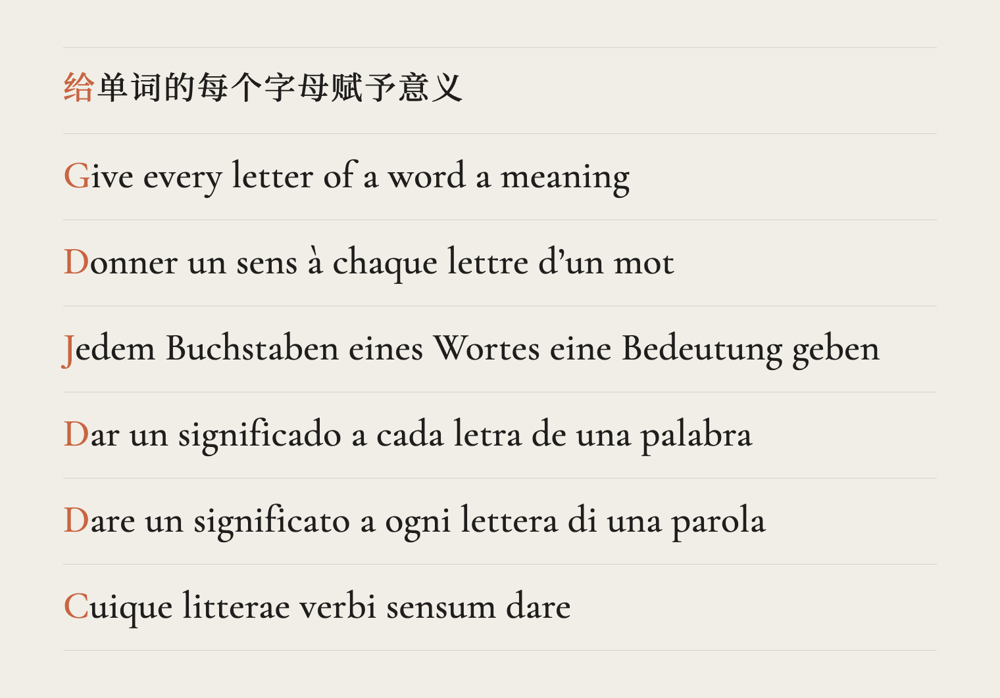
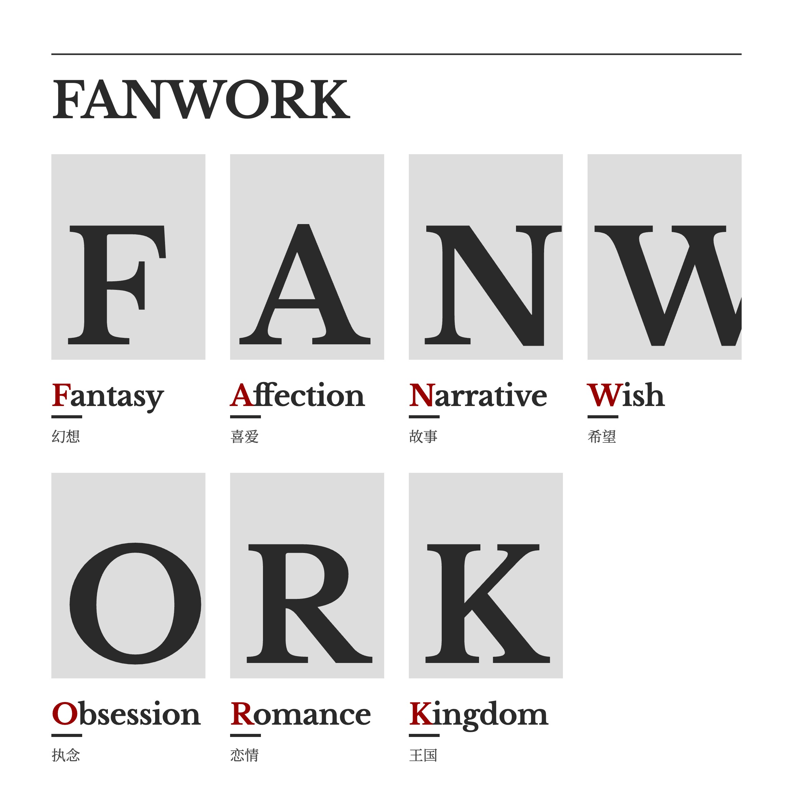
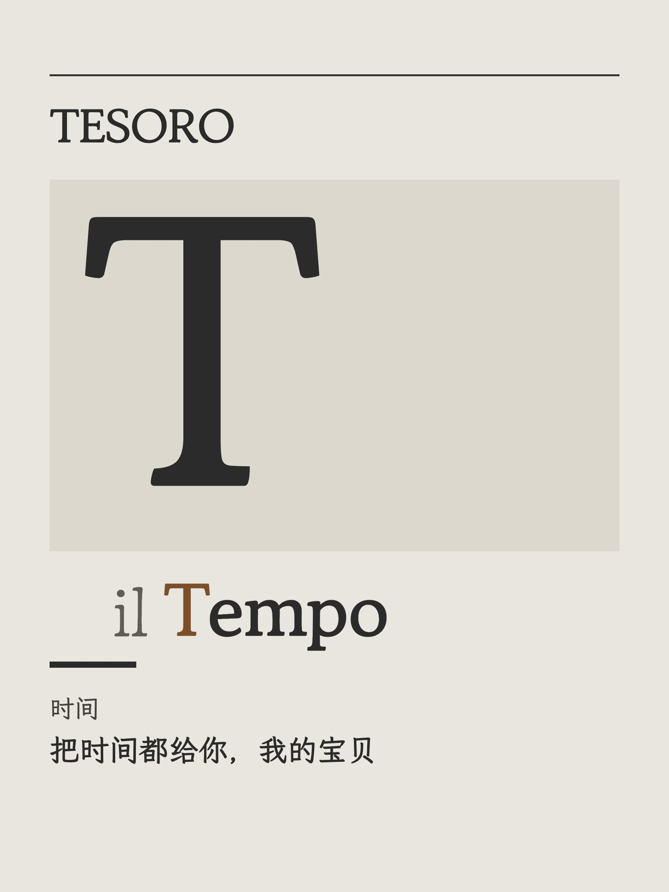
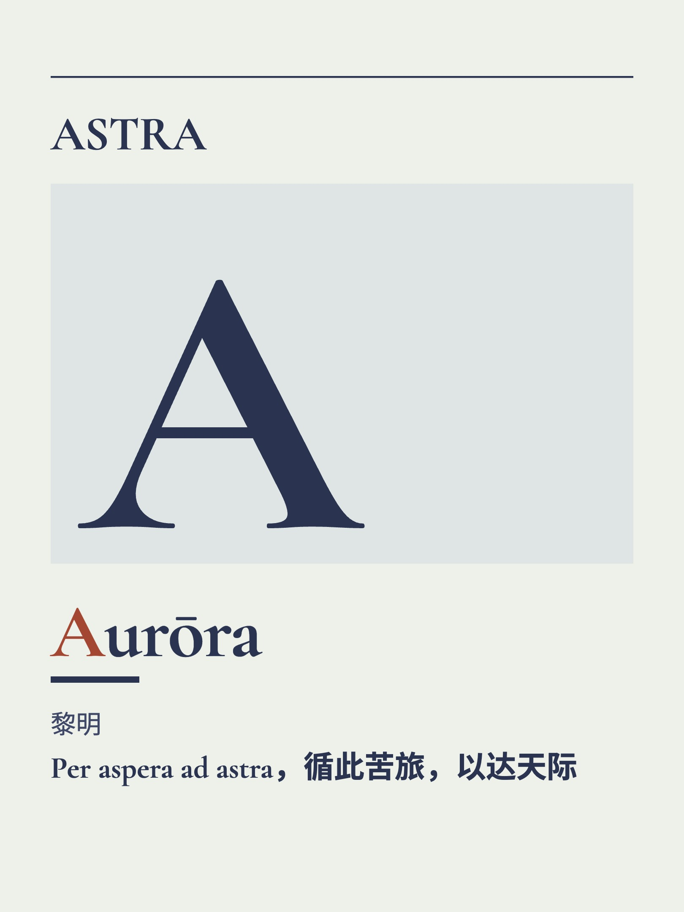
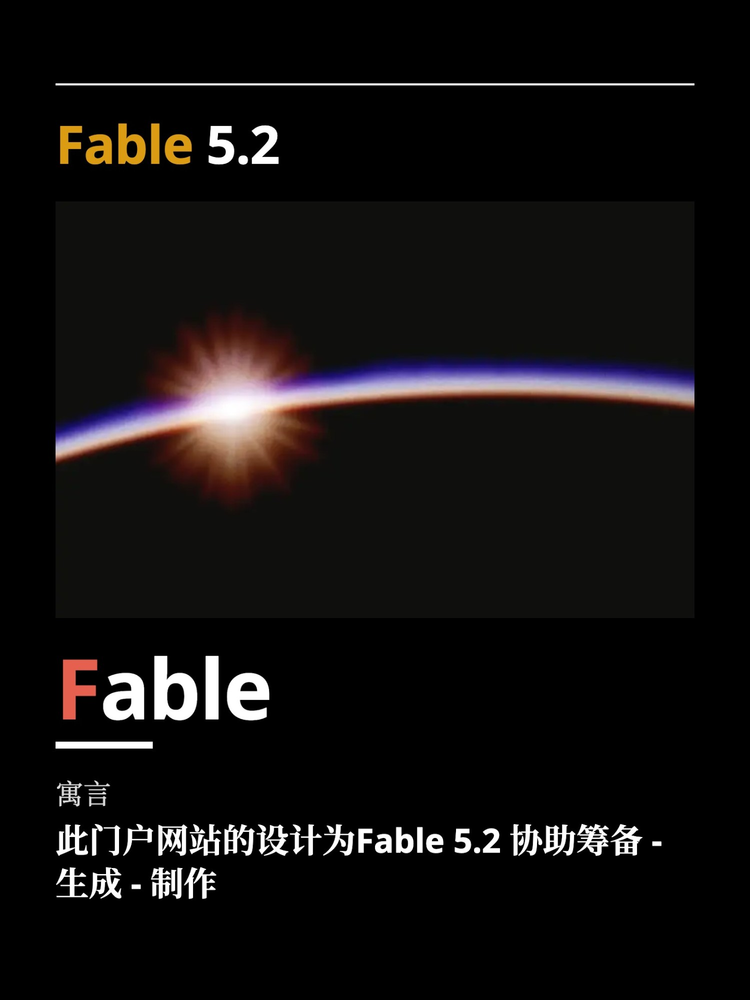

# 藏头 - Backronym

[中文](README.md) · English

<picture>
  <source media="(max-width: 640px)" srcset="design/brand/slogan-mobile.png">
  
</picture>

<p align="center">
  <a href="design/brand/trailer.mp4"></a>
</p>

<p align="center">A 15-second trailer. The image above is silent — <a href="design/brand/trailer.mp4">watch the original with sound</a>.</p>

Type a word, and match each letter with a word that starts with it and its meaning.

```
L  Living     alive, lifelike
I  Imagine    to picture, to suppose
F  Fearless   bold, brave
E  Eternal    everlasting           ← the initial is always vermilion
```

<p align="center">
  
  
  
  
</p>

<p align="center">All four were made in the web version and exported as they are. Themes, left to right: fandom, Dansaek, Monet, Table.</p>

## Where to use it

| Entry | Address |
|---|---|
| RedNote (Xiaohongshu) mini tool | Live on RedNote — search for “藏头 - Backronym”, or see the [launch note](https://www.xiaohongshu.com/discovery/item/6b060b4c000000001803898d?source=webshare&xhsshare=pc_web&xsec_token=AB_a6etllfjkD-BT7Grq9n69djZfqhKfgyQbqA_P-l5gc=&xsec_source=pc_share) |
| Project portal | <https://bydpass.com/backronym/> |
| Web version — opens in the browser, nothing to install | <https://bydpass.com/backronym/app/> |
| Host it yourself | See “03 Run it locally” below |

---

## 01　How to play

1. **Pick a word.** Choose your languages, enter a word and a Maker Name, or pick a preset word, then tap “Start filling”.
2. **Fill the letters.** Each character gets one cell. Type a word starting with that letter directly on the card, or browse the suggestion bar with “Next set” or “Random”.
3. **Complete it.** Meanings are filled in automatically from the word list and can be edited; add a caption and an image.
4. **Lay it out.** Choose Folio, Centered or your own adjustments under “Layout”, and switch themes under “Settings”.
5. **Finish.** Tap “Done” to export. The web version downloads images directly; inside RedNote you can save to Photos or post a note directly.

## 02　Features

- **Six languages.** English, French, German, Spanish, Italian and Latin, with over thirty thousand senses, Chinese and English meanings, noun articles, common verb forms and reverse lookup by Chinese meaning.
- **Edit on the image.** What you see on the card is what you export, as single images per cell or a combined grid.
- **Layouts and themes.** Two presets — Folio and Centered — plus ten layout switches, five built-in themes — fandom, Dansaek, Monet, Vienna and Table — with light and dark modes on selected themes, and a Chinese and English interface.
- **No generative AI.** Running this tool and all of its features neither depends on nor uses any generative AI. The word list is inspiration, not the answer — type your own word first.
- **Your content stays on your device.** The words, text and pictures you add are stored only on your device; apart from “Post a note”, which you tap yourself, the tool sends nothing out while it runs. Drafts are cleared automatically after 18 hours without changes.
- **Open source.** The code is released under GPL 3.0 or later. Take it home, deploy it, change it.

## 03　Run it locally

You can run the web version on your own computer or server. Node 22 or newer is all you need; there are no dependencies to install.

```bash
git clone https://github.com/bydpass/backronym.git
cd backronym
npm start          # builds the web version and serves it at http://127.0.0.1:8080
```

Another port: `npm start -- --port 9000`. To let other devices on the same network open it: `npm start -- --host 0.0.0.0`. The `dist/web/` folder produced by `npm run pack:web` is plain static files and can be handed to Nginx, Caddy or any static server. Drafts live in the browser and are kept per address, so a different address or port will not show earlier drafts.

## 04　Development

No build chain, no framework, no npm dependencies. Commands, directory layout, container constraints and the document index are in [docs/DEVELOPMENT.md](docs/DEVELOPMENT.md) (in Chinese); the release checklist is [RELEASE.md](RELEASE.md) (in Chinese).

## 05　License

© 2026 BeyondPassenger. Source code: <https://github.com/bydpass/backronym>

**In short** (the same wording as the credits page inside the app)

- **You may**: images made with this tool may be used commercially with attribution (you can write “Layout: Backronym (BeyondPassenger), CC BY 4.0, creativecommons.org/licenses/by/4.0”; meanings taken directly from the word lists stay under the word lists' license). The code may be modified and used commercially.
- **You may not**: distribute a modified program without giving the recipient its source; remove attribution or license notices; use the design files and documentation commercially.
- **Note**: third-party resources keep their own licenses; the license texts prevail in every case and this summary has no legal force; this tool comes with no warranty.

**License of each part**

| Part | License | Full text |
|---|---|---|
| Code (`app/`, `scripts/`, including interface text written in the code; the data files listed below excepted) | GPL-3.0-or-later (GNU General Public License version 3, or any later version of your choice) | [`LICENSE`](LICENSE) |
| Word lists for the five Western languages (`app/assets/lang/{fr,de,es,it,la}/words.js` and their source data under `review/`) | CC BY-SA 4.0 | [`LICENSES/CC-BY-SA-4.0.txt`](LICENSES/CC-BY-SA-4.0.txt) |
| Frequency ranks (`scripts/t19/pack-ranks.json`, and the score column of `review/lexicon/de/selection-baseline.tsv`): used only to order suggestions, compiled from the sources on the right | French, German, Spanish, Italian: word counts from FrequencyWords (Hermit Dave), merged to lemmas through Wiktionary's word forms, CC BY-SA 4.0. Latin: first the FREQ class of Whitaker's Words (the author's free-use statement is quoted on the credits page), then, within a class, the rank in the Dickinson College Commentaries core vocabulary (CC BY-SA 3.0 Unported). English: the frequency rank columns of ECDICT (frq, bnc; function words last), MIT | The CC-BY-SA-4.0, CC-BY-SA-3.0 and MIT texts under `LICENSES/`; Whitaker's statement is on the credits page |
| English word list | Derived from [ECDICT](https://github.com/skywind3000/ECDICT), MIT, © 2025 Linwei | [`LICENSES/MIT.txt`](LICENSES/MIT.txt) |
| Design files and documentation (`design/`, `docs/`) | CC BY-NC-SA 4.0 | <https://creativecommons.org/licenses/by-nc-sa/4.0/legalcode> |
| Images made with this tool | The layout contributed by this tool: CC BY 4.0. Text and photos added by the maker belong to the maker; meanings taken directly from the word lists stay under the word lists' license | [`LICENSES/CC-BY-4.0.txt`](LICENSES/CC-BY-4.0.txt) |
| Fonts | SIL Open Font License 1.1; copyright holders are listed at the top of the text | [`LICENSES/OFL-1.1.txt`](LICENSES/OFL-1.1.txt) |

This program comes with no warranty; see sections 15 and 16 of the GPL.

Third-party sources (Wiktionary, FrequencyWords, hyphenation patterns, block lists, icons and others) are listed one by one on the app's credits page and keep their own licenses. The source statements for each language's word list are also in the header of its `words.js`.

This English page is a translation of [README.md](README.md). If the two differ, the Chinese page is the one maintained first.
