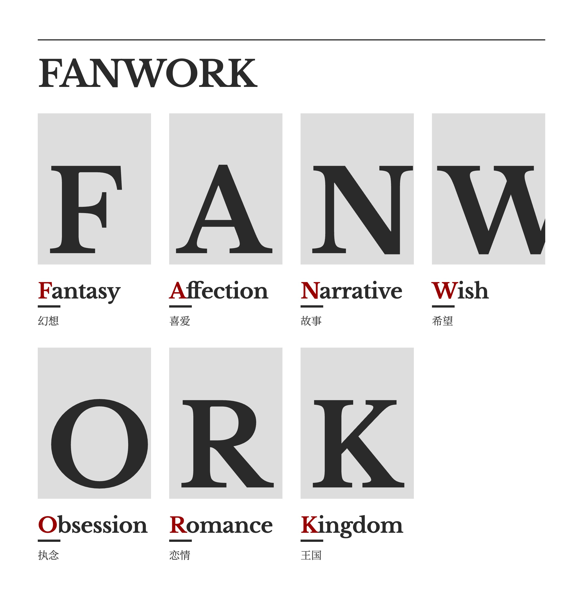
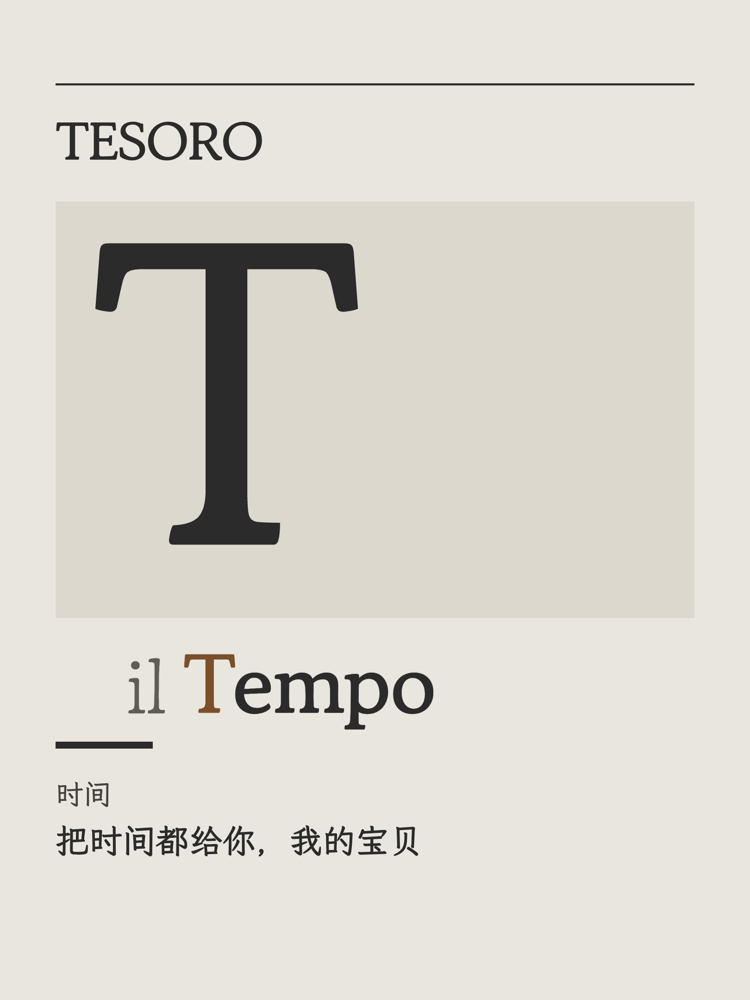
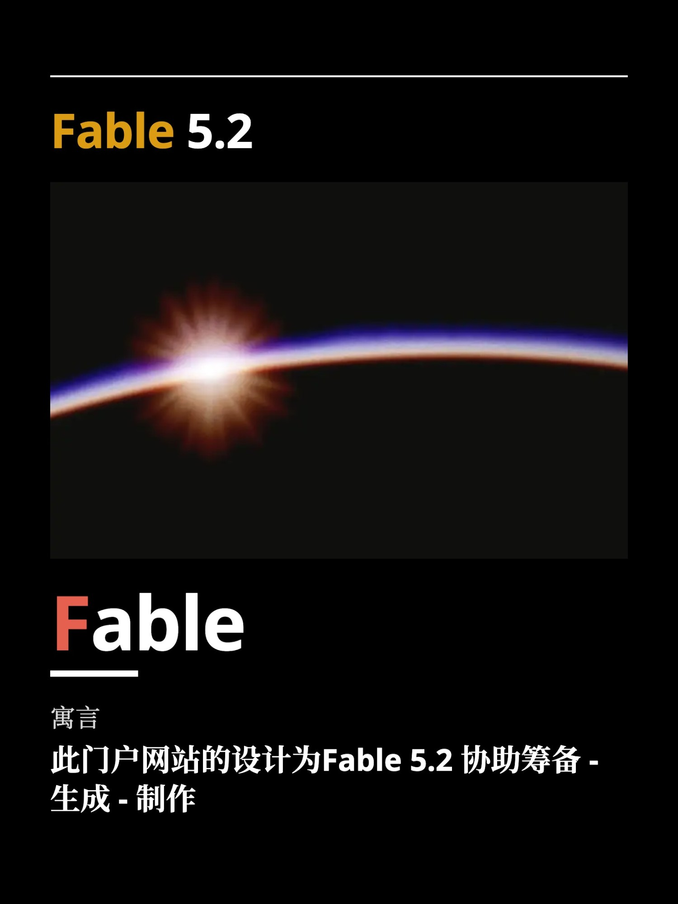

# 藏头 - Backronym

中文 · [English](README.en.md)

<picture>
  <source media="(max-width: 640px)" srcset="design/brand/slogan-mobile.png">
  
</picture>

<p align="center">
  <a href="design/brand/trailer.mp4"></a>
</p>

<p align="center">15 秒预告片。上面是无声的动图，<a href="design/brand/trailer.mp4">点这里看带声音的原片</a>。</p>

打一个单词，给单词的每个字母配一个同首字母的词及其意义。

```
L  Living     活的，逼真的
I  Imagine    想像，设想
F  Fearless   大胆的，勇敢的
E  Eternal    永恒的，永远的    ← 首字母标朱红
```

<p align="center">
  
  
  
  
</p>

<p align="center">四张都是用网页版做出来、直接导出的成品。主题依次是 fandom、单色画、印象派、表格。</p>

## 在哪里用

| 入口 | 地址 |
|---|---|
| 小红书小工具 | 已上架，在小红书搜索「藏头 - Backronym」，或看[首发笔记](https://www.xiaohongshu.com/discovery/item/6b060b4c000000001803898d?source=webshare&xhsshare=pc_web&xsec_token=AB_a6etllfjkD-BT7Grq9n69djZfqhKfgyQbqA_P-l5gc=&xsec_source=pc_share) |
| 项目门户 | <https://bydpass.com/backronym/> |
| 网页版（打开即用，不用安装） | <https://bydpass.com/backronym/app/> |
| 自己部署 | 见下文「03 本地部署」 |

---

## 01　怎么玩

1. **起词。** 选好语言，输入单词和填表人，或者直接选个预设词，点「开始填充」。
2. **填词。** 每个字符占一格，直接在卡上打一个同首字母的词；没思路时看候选栏，也能点「下一批」或「随机一个」。
3. **补全。** 词库会自动带出释义，可以自己改，再补上配文和配图。
4. **排版。** 在「版式」里选对开、居中或自己调，在「设置」里换主题。
5. **完成。** 点「完成」导出成图。网页版直接保存图片，小红书里可以存进相册，或直接发成笔记。

## 02　特性

- **六门语言。** 英、法、德、西、意、拉丁，共三万多条义项，支持中英双语释义、名词冠词、常用动词变位与中文反查。
- **在图上编辑。** 编辑时看到的卡片就是导出的成品，支持单图逐格导出和列阵合排。
- **版式与主题。** 提供对开、居中两套预设和十个微调开关，内置 fandom、单色画、印象派、分离派、表格五套主题，部分支持深浅切换；界面支持中英文。
- **不依赖生成式人工智能。** 本工具的运行及其功能不依赖、也不使用任何生成式人工智能。词库是灵感，不是答案，先打自己的词。
- **内容留在本机。** 你填的词、写的字、放的图只存在自己的设备上；除了你自己点的「发布笔记」，工具运行时不向外发送任何内容。草稿连续 18 小时无改动自动清除。
- **开源。** 代码以 GPL 3.0 or later 开源，可以抱回自己的电脑上部署、改造。

## 03　本地部署

可以在自己的电脑或服务器上跑网页版。只需要 Node 22 或更新的版本，不用安装任何依赖。

```bash
git clone https://github.com/bydpass/backronym.git
cd backronym
npm start          # 生成网页版，并在 http://127.0.0.1:8080 提供服务
```

换端口：`npm start -- --port 9000`。让同一网络里的其他设备也能打开：`npm start -- --host 0.0.0.0`。`npm run pack:web` 生成的 `dist/web/` 是纯静态文件，也可以直接交给 Nginx、Caddy 等任何静态服务器。草稿存在浏览器里，按地址分开，换一个地址或端口打开看不到之前的草稿。

## 04　开发

无构建链、无框架、无 npm 依赖。命令、目录结构、容器约束与文档索引见 [docs/DEVELOPMENT.md](docs/DEVELOPMENT.md)；上架清单见 [RELEASE.md](RELEASE.md)。

## 05　许可

© 2026 BeyondPassenger。源代码：<https://github.com/bydpass/backronym>

**省流**（与应用里「借物与版权」页是同一段文字）

- **可以**：用本工具做的图，署名即可商用（署名可写「版式：藏头 - Backronym（BeyondPassenger），CC BY 4.0，creativecommons.org/licenses/by/4.0」；图上直接取自词库的释义仍按词库的许可）；代码可以改，可以商用。
- **不可以**：把改过的程序分发给别人，却不向对方提供源码；删掉署名或许可声明；把设计稿与文档拿去商用。
- **注意**：第三方资源各守原许可；一切以许可原文为准，这段中文说明不具法律效力；本工具不提供担保。

**各部分的许可**

| 部分 | 许可 | 全文 |
|---|---|---|
| 代码（`app/`、`scripts/`，含写在代码里的界面文案；下面单列的数据文件除外） | GPL-3.0-or-later（GNU 通用公共许可证第 3 版，或由你选择的任一更新版本） | [`LICENSE`](LICENSE) |
| 五门西文词库（`app/assets/lang/{fr,de,es,it,la}/words.js` 及其在 `review/` 下的来源数据） | CC BY-SA 4.0 | [`LICENSES/CC-BY-SA-4.0.txt`](LICENSES/CC-BY-SA-4.0.txt) |
| 词频排名（`scripts/t19/pack-ranks.json`，以及 `review/lexicon/de/selection-baseline.tsv` 的得分列）：只用来给候选词排序，由下列来源的数据整理而成 | 法、德、西、意：FrequencyWords（Hermit Dave）的词频计数，经维基词典的词形归并到原形，CC BY-SA 4.0；拉丁语：先按 Whitaker's Words 的 FREQ 等级（作者的自由使用声明，原句见借物页），同级再按 Dickinson College Commentaries 核心词表的名次（CC BY-SA 3.0 Unported）；英语：ECDICT 的词频名次列（frq、bnc；功能词排在最后），MIT | `LICENSES/` 下的 CC-BY-SA-4.0、CC-BY-SA-3.0、MIT 全文；Whitaker 的声明见借物页 |
| 英语词库 | 派生自 [ECDICT](https://github.com/skywind3000/ECDICT)，MIT，© 2025 Linwei | [`LICENSES/MIT.txt`](LICENSES/MIT.txt) |
| 设计稿与文档（`design/`、`docs/`） | CC BY-NC-SA 4.0 | <https://creativecommons.org/licenses/by-nc-sa/4.0/legalcode> |
| 用本工具做出的图 | 属于本工具的版式部分 CC BY 4.0；制作者自己写的文字、放的照片归制作者，直接取自词库的释义仍按词库的许可 | [`LICENSES/CC-BY-4.0.txt`](LICENSES/CC-BY-4.0.txt) |
| 字体 | SIL Open Font License 1.1，各版权人见全文开头 | [`LICENSES/OFL-1.1.txt`](LICENSES/OFL-1.1.txt) |

本程序不提供任何担保，详见 GPL 第 15、16 条。

第三方来源（维基词典、FrequencyWords、断词模式、屏蔽词表、图标等）逐个列在应用的「借物与版权」页，各守原许可；各语言词库的来源声明另附在对应 `words.js` 的文件头。
